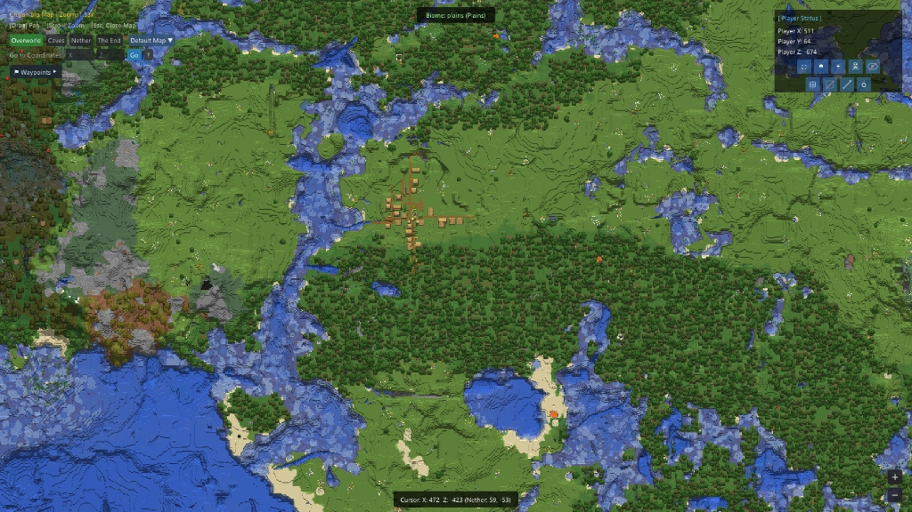

# ChiyanMap

**English** | [简体中文](./README_zh.md)

[](https://github.com/qing85566/ChiyanMap/releases)
[-green)](https://www.minecraft.net/)
[](https://github.com/LiteLDev/LeviLamina)
[](https://en.cppreference.com/w/cpp/23)
[](./LICENSE)

**ChiyanMap** is a high-performance, client-side map and radar mod designed exclusively for **Minecraft Bedrock Edition (Windows)**. Built on the **LeviLamina** native framework and deeply integrated into the DirectX 11 / 11On12 rendering pipeline, it runs purely within the client—requiring zero server plugins for a buttery-smooth real-time HUD map experience.

> ⚠️ **Disclaimer**: All code in this mod was generated and written by **AI (Artificial Intelligence)**. By using this mod, you acknowledge this and assume all associated risks.

> 📖 **Comprehensive Guides**: Detailed documentation and tutorials are available in the [Docs Directory](./docs/README.md).



---

## 🌟 Key Features

- **🗺️ Real-Time MiniMap**
  - Seamless toggle between circular and square shapes, free dragging, scaling, and view distance radius adjustment.
  - Smooth player-direction rotation or locked to North; smart potion HUD push-box avoidance.
  - Multi-distance layered entity radar (passive mobs, players, hostile mobs, and tamed pets with glowing auras).

- **🌍 Fullscreen World Map**
  - Ultra-smooth panning and zooming, instant coordinate jumping, and cross-dimension viewport roaming.
  - Selection box export of high-resolution map PNGs (with customizable hotkey).
  - Integrated Seed Map supporting structure distribution, slime chunk, and biome predictions.

- **📍 Waypoints & Death Points System**
  - Waypoint Sets management, category drawer filtering, custom colors, and icons.
  - In-game 3D beacon beams and distance HUD indicators; hotkey set switching with smooth on-screen toast notifications.
  - High-precision automatic death location recording, one-click conversion to permanent waypoints, and `Ctrl+Z` undo restoration for accidental deletions.

- **🌌 Multiworld & Instance Roaming**
  - Separate isolation and interconnected roaming between server worlds and custom map instances, automatically detecting spawn changes.
  - Deep cascade cleanup upon instance deletion—zero leftover orphaned files.

- **⛏️ Cave Map & Anarchy Detection**
  - Vertical depth-sliced cave X-ray mode reveals underground layouts at a glance.
  - Anarchy chunk history modification detection to identify player structures and terrain modifications.

- **✏️ Drawing & Annotation System**
  - Freehand drawing on the fullscreen map with pens, polylines, arrows, rectangles, circles, text labels, and layer management.
  - Full undo (`Ctrl+Z`) and redo (`Ctrl+Y`) support.

- **⚡ Ultimate Performance & Stability**
  - Multi-threaded asynchronous layered disk writes and self-healing in-memory cache management.
  - Full-pipeline exception barrier across DXGI Present—0 crashes, 0 frame drops.
  - Native independent IME input host and 16 built-in localization languages.

---

## ⌨️ Default Hotkeys

| Key | Action | Key | Action |
| :--- | :--- | :--- | :--- |
| **`M`** | Toggle Fullscreen World Map | **`U`** | Open Waypoint Manager |
| **`N`** | Toggle MiniMap Visibility | **`Y`** | Toggle MiniMap Shape (Circle / Square) |
| **`J`** | Toggle MiniMap Rotation (Player / North) | **`Shift` + Drag** | Select Box to Export PNG on World Map |
| **`Tab` (Hold)** | Temporarily Show/Hide Entity Heads on Map | **`Ctrl + Z`** | Undo Action / Restore Deleted Waypoint |

> 💡 All hotkeys can be rebound or combined in the settings panel (gear icon on the world map).

---

## 📦 Installation

1. **Download the Mod**: Go to [ChiyanMap Releases](https://github.com/qing85566/ChiyanMap/releases) and download the latest mod release (`.zip` or `.dll`).
2. **Install LeviLauncher**: Go to [LeviLauncher Releases](https://github.com/LiteLDev/LeviLauncher/releases) to download and install LeviLauncher.
3. **Download Compatible Game Version**: Open LeviLauncher, click the **"Download"** button on the left sidebar, and install a Minecraft Bedrock version that supports LeviLamina and is compatible with this mod.
4. **Select Instance**: Click the **"Launch"** button on the left sidebar to return to the dashboard, then locate and select your newly installed Minecraft instance from the list.
5. **Import Mod**: Click **"Manage Mods"**, then click the **"Import .zip/dll"** button in the upper-right corner. Select the mod file downloaded in Step 1 and import it.
6. **Launch Game**: Return to the dashboard and launch the game to enjoy!

---

## 🛠️ Building from Source

### Prerequisites
- **Operating System**: Windows 10 / 11 (x64)
- **Compiler**: [Visual Studio 2022](https://visualstudio.microsoft.com/) (Desktop development with C++, MSVC v143+)
- **Build Tool**: [XMake](https://xmake.io/) (3.0.0+)
- **Standard**: C++23

### Build Steps
```powershell
# 1. Clone repository
git clone https://github.com/qing85566/ChiyanMap.git
cd ChiyanMap

# 2. Configure and build (Release)
xmake f -m release
xmake

# Compiled binaries will be generated in bin/ChiyanMap/
```

---

## 📂 Repository Structure

```text
ChiyanMap/
├── .github/                 # GitHub CI/CD workflows and Issue/PR templates
├── assets/                  # Media assets and in-game preview screenshots
├── docs/                    # Complete user documentation and guides (en/ & zh/ suites)
├── heads/                   # High-resolution entity radar icon assets (PNG)
├── lang/                    # Localization dictionaries for 16 languages (JSON)
├── src/                     # C++23 core source code
│   ├── hooks/               # LeviLamina & MinHook engine hooks
│   │   ├── BeaconRenderHook.h   # In-world 3D beacon beam rendering hook
│   │   ├── DX11Hook.h           # DX11/11On12 SwapChain Present & ImGui render barrier
│   │   ├── HookRegistry.h/.cpp  # Centralized hook registration and lifecycle management
│   │   ├── PlayerHook.h         # Player tick, rotation, dimension shift, and death hooks
│   │   └── UIRenderHook.h       # In-game UI coordination and input arbitration
│   ├── mod/                 # Mod entry point and lifecycle safety
│   │   ├── ChiyanMap.h/.cpp     # Mod lifecycle, config hot-reloading, and hotkey dispatch
│   │   └── MemoryOperators.cpp  # Safe cross-DLL new/delete memory operator overloads
│   ├── render/              # Shading, textures, and atlas rendering
│   │   ├── BlockColorMap.h/.cpp # Block ID/State to RGBA color and elevation hillshading
│   │   ├── EntityIconManager.h  # Entity head icon texture loading, caching, and radar rendering
│   │   └── MapGuiAtlas.h        # Procedural and vector GUI icon atlas rendering
│   ├── state/               # State machine, data models, and business logic
│   │   ├── AnarchyManager.h/.cpp     # Anarchy chunk modification history and footprint detection
│   │   ├── DatabaseManager.h/.cpp    # Persistent storage and caching backend
│   │   ├── DeathPointManager.h/.cpp  # Death point tracking, history, and Ctrl+Z undo restoration
│   │   ├── DrawingManager.h/.cpp     # World map vector drawings, annotations, and layer undo/redo
│   │   ├── LanguageManager.h/.cpp    # 16-language i18n loader and real-time switching
│   │   ├── MapCacheManager.h/.cpp    # Multi-threaded layered async disk writing & self-healing LRU cache
│   │   ├── MapRenderState.h/.cpp     # MiniMap and World Map ImGui rendering coordinator
│   │   ├── MultiworldManager.h/.cpp  # Multiworld/dimension instance isolation and cascade cleanup
│   │   ├── SeedMapIconAtlas.h        # Biome and structure icon atlas for Seed Map
│   │   ├── SeedMapManager.h/.cpp     # Seed Map generation, structure prediction, and biome queries
│   │   ├── SpecialGridManager.h/.cpp # Coordinate grids, chunk boundaries, and slime chunk overlays
│   │   └── WaypointManager.h/.cpp    # Waypoint sets, categorization, drawer filtering, and beacons
│   └── worldgen/            # Bedrock world generation wrappers
│       ├── BedrockBiomeValidator.h/.cpp # Bedrock biome validation and derivation
│       ├── Random.h/.cpp                # Bedrock PRNG (pseudo-random number generators)
│       ├── StructureCatalog.h/.cpp      # Catalog of Bedrock structure generation traits
│       ├── TileQuery.h/.cpp             # Tile spatial query and chunk calculation pipeline
│       └── WorldGenTypes.h              # Data structures and geometry types for world generation
├── third_party/             # Third-party dependencies
│   └── cubiomes-bedrock/    # High-performance C library for Bedrock biome & structure algorithms
├── .clang-format            # Code formatting rules
├── .clang-tidy              # Static code analysis configuration
├── LICENSE                  # GNU General Public License v3.0 text
├── manifest.json            # LeviLamina mod manifest
├── tooth.json               # LeviLamina package manager configuration
└── xmake.lua                # XMake build automation script
```

### Module Responsibilities

- **`src/mod/` (Mod Lifecycle)**: Core initialization entry point. Manages subsystem bootstrapping during LeviLamina load, registers commands and event callbacks, listens for hotkeys, and provides safe memory allocators.
- **`src/hooks/` (Engine Hooks)**: MinHook-based hooks intercepting DirectX 11 `Present` / `ResizeBuffers` to run the ImGui render pipeline with full exception safety, as well as player tick hooks to synchronize coordinates, rotations, dimension shifts, and death events.
- **`src/render/` (Rendering Pipeline)**: Computes block colors, elevation hillshading, dynamic entity icon loading and caching, and procedural vector GUI icons.
- **`src/state/` (State Machine & Logic)**: The core engine of the mod. Handles MiniMap and World Map render states, multi-threaded asynchronous chunk tile caching, waypoint/deathpoint persistence, multiworld instance management, vector drawing layers with undo/redo, seed map computation, and 16-language localization.
- **`src/worldgen/` & `third_party/` (Worldgen & Algorithms)**: Integrates the ported C `cubiomes-bedrock` library to predict Bedrock biomes, slime chunks, and structures on the client side without needing server permissions.
- **`docs/` (Documentation)**: Comprehensive 9-part user guide and tutorial collection covering every aspect of the mod.
- **`heads/` & `lang/` (Assets & Locales)**: High-resolution mob head icons for the entity radar and JSON dictionaries for 16 supported languages.

---

## 📄 License

This project is licensed under the [GNU General Public License v3.0 (GPL-3.0)](./LICENSE).
